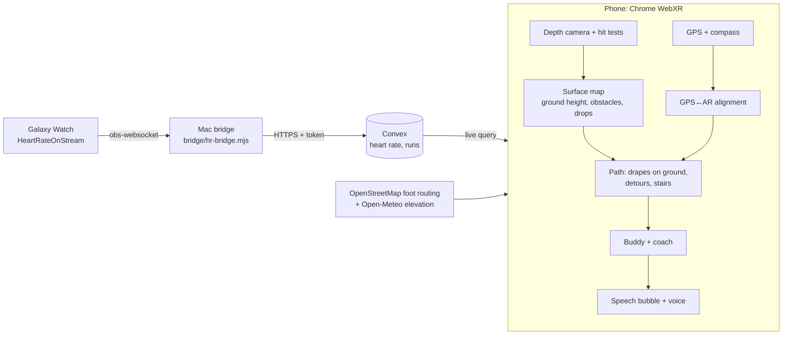

# ReReV

An AR running buddy. A cartoon partner runs a couple of metres ahead of you on a glowing path laid over the real ground, paces itself to your goal and your live heart rate, talks to you, steers around obstacles it sees through the phone's depth camera, and climbs stairs with you.

> _Project story, inspiration and what we learned: to be written by Jozeph._

## Try it on a laptop (no phone needed)

```bash
npm install
npm run dev
```

Open http://localhost:5173. Without AR, the app runs a **preview simulation**: a simulated runner, depth camera, GPS and compass.
- **Quick start here:** the buddy follows you. The simulated runner picks its own way: down an L-shaped hallway (started facing 12° off, so a straight line would hit the wall), round a crate, round the corner, diagonally across a street, past a bin, then back the way it came. The path ahead bends onto the runner's line within a second or two, and when the runner gets past the buddy it pops back in ahead. On a phone it's the same: walk where you like and the path follows. Add `?course=obstacles` for the old fixed course instead (a crate to bend around, a ramp, stairs up to a landing, and a barrier), to check obstacle handling against.
- **Walk your course:** tap Record and the simulated walker loops round a table (add `?course=line` for an out-and-back along a corridor instead), then the buddy runs it with you, with a bag dropped on the course to steer round. Finish shows the summary over the view with Run again, New course and Exit. On a phone, you walk the course yourself: end near the start for laps, anywhere else to run there and back. AR stays open between runs, because the course only exists while it does. This is the one for a judging table.
- **Plan a run:** a real OpenStreetMap route. The simulated compass starts 20° wrong and GPS jitters by ±4 m, so you can watch the route anchoring correct itself.

## Run it on an Android phone

WebXR AR needs Chrome on an ARCore phone, over https. The latest build is live at **https://rerev.jkunistuff.workers.dev** (`npm run deploy` publishes a new one to Cloudflare). To test code changes before deploying, keep the dev server running and tunnel it:

```bash
cloudflared tunnel --no-autoupdate --url http://localhost:5173
```

Open the printed `https://…trycloudflare.com` link on the phone.

**Testing outdoors?** Add `?debug` to the link, or long-press the "Buddy" tile during a run, for a live readout of what the sensors are doing: tracking, depth points, ground-ray hits, GPS accuracy, compass, how many GPS and route matches the route fit is using, and how far you are from the drawn path.

## Heart rate from a Galaxy Watch

**Over Bluetooth (anywhere, including outdoors):** install a Wear OS app that makes the watch act as a Bluetooth heart-rate strap (Heart for Bluetooth or HR2VP), then tap "Connect your watch" on the ReReV home screen and pick it. It reconnects by itself after that.

**Through the laptop (at a desk):**

1. Install **HeartRateOnStream** on the Wear OS watch.
2. On the Mac: `npm run bridge`. It prints the Mac's address.
3. In the watch app, set the OBS address to that IP and port `4455`.

Readings go watch → bridge → Convex → phone in about a second. No watch? `npm run bridge -- --simulate` fakes a warm-up, a spike and a recovery. During a run, tap the heart tile for a manual demo override.

## How it works



- **Ground and obstacles** (`src/world/surfaceMap.ts`): depth points become 3D positions in the room and are judged by their height above the *local* ground. That way slopes are followed, things sticking up 15 cm+ are obstacles, and drop-offs are flagged. Phone depth is noisy while walking, so no single reading makes a hazard: each 20 cm cell weighs up, over time, how much of what it saw was obstacle, drop or floor, trusting near readings far more than distant ones, and a hazard is confirmed only when it clearly dominates, seen from within 2.8 m, from more than one spot, with a neighbouring cell agreeing. The phone's floor detection outranks depth: it sets ground heights, rules out drops where it sees floor, re-measures depth frames that sit off the floor from the floor they show (out to where it checked them), and moves the whole map when the phone's world drifts up or down. On map routes, kerbs (up to 20 cm) are stepped over rather than avoided. Hazards are remembered while out of view and cleared once bare floor is seen there again. Cells where obstacle readings are piling up but not yet confirmed are *suspects*.
- **Path** (`src/world/path.ts`): drapes onto learned ground and plans, 10 times a second, how far to the side (up to 1.2 m) each point of the 6 m ahead runs, so the buddy's 50 cm-wide body never overlaps a flagged cell, keeps 20 cm more where it can, and goes round on the side with more room; with no way through it turns red and stops short. A follow-me re-lay keeps the detour it was making. It recognises stairs going up from a steadily rising height profile that runs across the way (a chair or bin doesn't) and climbs them; steps going down stop with a warning.
- **Pacing** (`src/partner/pacing.ts`, `src/partner/partner.ts`): in Quick start and on courses the buddy goes your own speed (averaged over 1.5 s), drifting gently back to a 2 m lead; on a planned route it holds the goal pace while you keep up and eases down to yours as you drop back, rather than stopping. It jogs on the spot only once you've actually stopped, and sets off again as you do. Heart-rate effort scales either; hills slow the goal pace. Unseen ground doesn't hold it back (confirmed hazards stop or steer it), with two exceptions where it holds to the ground it has seen and asks you to point the phone ahead: when depth that had been seeing floor 2.5 m+ ahead stops moving on as you walk towards it (something in the way, likely before it's confirmed), and when the camera has seen nothing ahead for 3 s. It also waits half a metre short of a suspect cell until that's confirmed (and steered round) or ruled out, and a follow-me pick-up never lands it on one.
- **Route anchoring** (`src/geo/alignment.ts`, `src/run/routeRun.ts`): the route starts at your feet, pointed by the compass. In the first few metres, before GPS can say much, "you're on the route here" matches (sideways only) fix the compass heading. After that, a weighted fit of the GPS track against AR tracking keeps it glued on. Progress along the route uses your direction of travel, so out-and-back streets don't confuse it. `npm run bench:align` simulates 40 runs per route with a 20° compass error and ±4 m GPS, for a runner on the pavement and one following the drawn line. The drawn route ends up about 0.5 m from the real one, and route matching never does worse than GPS alone.
- **Callouts** (`src/run/callouts.ts`): the buddy calls turns about 30 m before them, plus kilometre splits, halfway and the final stretch.
- **Voice lines** (`src/voice/lines.ts`): everything the buddy says out loud is a fixed line from one catalog, so it can be recorded once. The voice says the generic line ("Left turn coming up!", "One K done!"); the speech bubble carries the specifics ("Left onto Richard Rd in 30 m", "1 km done in 5:57"). A line plays `public/audio/lines/<id>.mp3` if that id is listed in `manifest.json`, and otherwise the browser voice reads its text. `npm run voice:lines` writes the recording script to `voice-script/lines.csv` (id, text, mood, delivery note, filename) and rebuilds the manifest from the clips in the folder.
- **Talking to the buddy** (`src/voice/conversation.ts`, `convex/buddy.ts`): clear commands ("stop", "faster") and yes/no answers are matched on the phone. Anything softer goes to Claude Haiku, which picks an action and one of the lines allowed for it, so "I'm tired" gets "Want to take a break?" rather than an instant stop. Without an API key, soft phrases get a local guess and the rest "Sorry, I didn't catch that."
- **Coach** (`src/partner/coach.ts`): plain rules on heart rate. Above the zone it eases off, then takes a breather and resumes on recovery; below the zone it picks up the pace. The summary shows how much of the run you spent in your zone, with a heart-rate chart.
- **Field replay** (`scripts/replay.ts`, `src/debug/replay.ts`): walks record the phone's pose, depth grid and floor hits to Convex (tap Mark when something looks wrong). `npm run replay` lists sessions; `npm run replay -- <session>` replays one through the real surface map, path and buddy and prints a timeline (state changes, blocks and why, detours, per-second depth verdicts and heights, marks in detail) plus how closely it matches what the phone did. `--tune obstacleMin=0.2` tries other thresholds; `--dump-marks` writes the point clouds around each mark as CSV. `--follow` lays Quick start runs following the runner from the recorded camera track (even ones recorded with the old fixed path), `--fixed` the other way round; each run ends with how far the path ahead (+2 to +6 m) stayed from where the runner actually went, and how close the buddy came to flagged cells. It also says how steadily the buddy paced: time in each state, state switches per minute, dead stops, which animation clip played and how often it changed, and its lead while the runner walked. Sessions are cached in `field-recordings/`.

## Tests

`npm test` runs the logic that can be checked without a phone: kerbs and steps in the surface map, the alignment fit, route progress on out-and-back streets, coach breathers, spoken callouts, voice intents, the line catalog, the yes/no flow and the speech queue. `npm run bench:align` is the slower alignment benchmark.

## Stack

three.js (WebXR), TypeScript, Vite, Convex, Leaflet with CARTO/OpenStreetMap tiles, OSRM foot routing (FOSSGIS), Open-Meteo elevation, Chrome speech recognition and synthesis.

## Environment

`npx convex dev` writes `.env.local` (`VITE_CONVEX_URL`, `VITE_CONVEX_SITE_URL`). The bridge token lives in `.env.local` as `HR_BRIDGE_TOKEN` and on the Convex deployment (`npx convex env set HR_BRIDGE_TOKEN …`).
