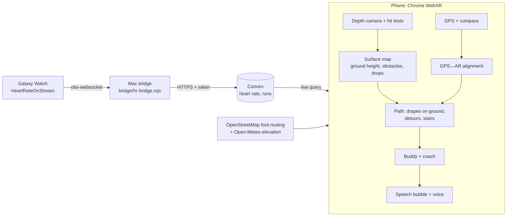

# ReReV

An AR running buddy. A cartoon partner runs a couple of metres ahead of you on a glowing path laid over the real ground, paces itself to your goal and your live heart rate, talks to you, steers around obstacles it sees through the phone's depth camera, and climbs stairs with you.

> _Project story, inspiration and what we learned: to be written by Jozeph._

## Try it on a laptop (no phone needed)

```bash
npm install
npm run dev
```

Open http://localhost:5173. Without AR, the app runs a **preview simulation**: a simulated runner, depth camera, GPS and compass.
- **Quick start here:** a course with a crate on the path (watch it bend around), a ramp, stairs, and a barrier.
- **Plan a run:** a real OpenStreetMap route. The simulated compass starts 20° wrong and GPS jitters by ±4 m, so you can watch the route anchoring correct itself.

## Run it on an Android phone

WebXR AR needs Chrome on an ARCore phone, over https. Keep the dev server running, then tunnel it:

```bash
cloudflared tunnel --no-autoupdate --url http://localhost:5173
```

Open the printed `https://…trycloudflare.com` link on the phone.

## Heart rate from a Galaxy Watch

1. Install **HeartRateOnStream** on the Wear OS watch.
2. On the Mac: `npm run bridge`. It prints the Mac's address.
3. In the watch app, set the OBS address to that IP and port `4455`.

Readings go watch → bridge → Convex → phone in about a second. No watch? `npm run bridge -- --simulate` fakes a warm-up, a spike and a recovery. During a run, tap the heart tile for a manual demo override.

## How it works



- **Ground and obstacles** (`src/world/surfaceMap.ts`): depth points become 3D positions in the room and are judged by their height above the *local* ground. That way slopes are followed, things sticking up 15 cm+ are obstacles, and drop-offs are flagged. Hazards are remembered while out of view and cleared once bare floor is seen there again.
- **Path** (`src/world/path.ts`): drapes onto learned ground, side-steps blocked stretches (±0.6 / 0.9 / 1.2 m), and turns red with no way around. It recognises stairs going up from a steadily rising height profile and climbs them; steps going down stop with a warning.
- **Route anchoring** (`src/geo/alignment.ts`): one GPS fix plus the compass places the route, then a weighted best-fit of the GPS track against AR tracking keeps refining it. In simulation it converges to under a metre after about 80 m, from a 25° compass error.
- **Coach** (`src/partner/coach.ts`): plain rules on heart rate. Above the zone it eases off, then takes a breather and resumes on recovery; below the zone it picks up the pace.

## Stack

three.js (WebXR), TypeScript, Vite, Convex, Leaflet with CARTO/OpenStreetMap tiles, OSRM foot routing (FOSSGIS), Open-Meteo elevation, Chrome speech recognition and synthesis.

## Environment

`npx convex dev` writes `.env.local` (`VITE_CONVEX_URL`, `VITE_CONVEX_SITE_URL`). The bridge token lives in `.env.local` as `HR_BRIDGE_TOKEN` and on the Convex deployment (`npx convex env set HR_BRIDGE_TOKEN …`).
